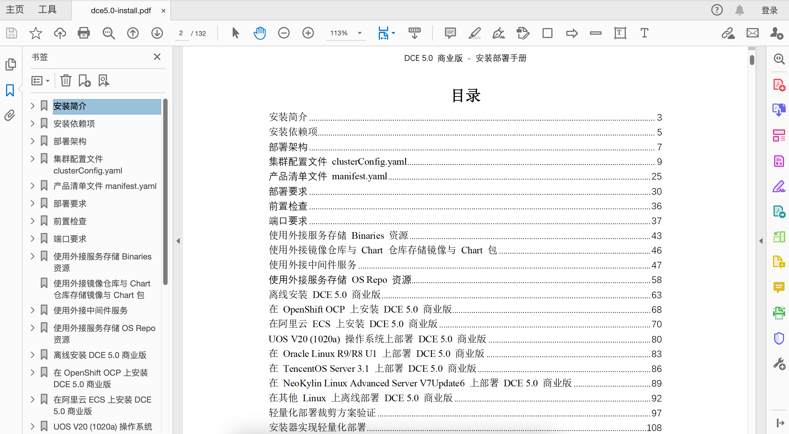

# Download Hub

Currently, only offline packages are provided in the download center. For online installation methods, refer to [Online Installation](../install/index.md).

## Download Dependencies

| Latest Package | Version | Size | Download | Date |
| ------ | ---- | ---- | ---- |-------- |
| prerequisite_v0.45.0_amd64.tar.gz | v0.45.0 | 143.17 MB | [:arrow_down: Download](https://qiniu-download-public.daocloud.io/DaoCloud_Enterprise/dce5/prerequisite_v0.45.0_amd64.tar.gz) | 2026-10-14 |
| prerequisite_v0.45.0_arm64.tar.gz | v0.45.0 | 129.28 MB | [:arrow_down: Download](https://qiniu-download-public.daocloud.io/DaoCloud_Enterprise/dce5/prerequisite_v0.45.0_arm64.tar.gz) | 2026-10-14 |

## Download d.run Token Factory

This product is an integrated platform built for AI intelligent computing scenarios.

| Latest Package | Version | Download | Date |
| ----- | ----- | ---- | --------- |
| offline-v0.45.0-arm64.tar | v0.45.0 | [:arrow_right: Go to Download](./tf/tf-installer-v0.45.0.md) | 2026-10-14 |
| offline-v0.45.0-amd64.tar | v0.45.0 | [:arrow_right: Go to Download](./tf/tf-installer-v0.45.0.md) | 2026-10-14 |

[More Historical Versions](./tf/index.md){ .md-button }

## Download d.run AI OS

This product is suitable for delivering stable and efficient AI services to all departments of an enterprise.

| Latest Package | Version | Download | Date |
| ----- | ----- | ---- | --------- |
| offline-v0.45.0-arm64.tar | v0.45.0 | [:arrow_right: Go to Download](./drun/drun-installer-v0.45.0.md) | 2026-10-14 |
| offline-v0.45.0-amd64.tar | v0.45.0 | [:arrow_right: Go to Download](./drun/drun-installer-v0.45.0.md) | 2026-10-14 |

[More Historical Versions](./drun/index.md){ .md-button }

## Download DaoCloud Enterprise

### Download DCE Community

This version is dedicated to the community and is available for free trial.

| Latest Package | Version | Download | Date |
| -------- | ---- | --- | ------- |
| offline-community-v0.45.0-arm64.tar | v0.45.0 | [:arrow_right: Go to Download](./free/dce5-installer-v0.45.0.md) | 2026-10-14 |
| offline-community-v0.45.0-amd64.tar | v0.45.0 | [:arrow_right: Go to Download](./free/dce5-installer-v0.45.0.md) | 2026-10-14 |

[Legacy Packages for DCE Community](./free/dce5-installer-history.md){ .md-button }

### Download DCE Enterprise

This version is suitable for private cloud, hybrid cloud, multicloud, microservices and other scenarios, providing a variety of customizable cloud native modules.

| Latest Package | Version | Download | Date |
| ----- | ----- | ---- | --------- |
| offline-v0.45.0-arm64.tar | v0.45.0 | [:arrow_right: Go to Download](./business/dce5-installer-v0.45.0.md) | 2026-10-14 |
| offline-v0.45.0-amd64.tar | v0.45.0 | [:arrow_right: Go to Download](./business/dce5-installer-v0.45.0.md) | 2026-10-14 |

[Legacy Packages for DCE Enterprise](./business/dce5-installer-history.md){ .md-button }

## Download Addons

DaoCloud provides comprehensive Addons for different use cases, which can be downloaded and used as needed.

| Latest Package | Version | Download | Date |
|--------| ---- | --- | --------- |
| jenkins-addon-offline-package-v0.44.0-arm64.tar.gz | v0.44.0 | [:arrow_right: Go to Download](./addon/v0.44.0.md) | 2026-09-16 |
| jenkins-addon-offline-package-v0.44.0-amd64.tar.gz | v0.44.0 | [:arrow_right: Go to Download](./addon/v0.44.0.md) | 2026-09-16 |
| metax-addon-offline-package-v0.44.0-amd64.tar.gz | v0.44.0 | [:arrow_right: Go to Download](./addon/v0.44.0.md) | 2026-09-16 |
| gpu-addon-offline-package-v0.44.0-arm64.tar.gz | v0.44.0 | [:arrow_right: Go to Download](./addon/v0.44.0.md) | 2026-09-16 |
| gpu-addon-offline-package-v0.44.0-amd64.tar.gz | v0.44.0 | [:arrow_right: Go to Download](./addon/v0.44.0.md) | 2026-09-16 |
| standard-addon-offline-package-v0.44.0-arm64.tar.gz | v0.44.0 | [:arrow_right: Go to Download](./addon/v0.44.0.md) | 2026-09-16 |
| standard-addon-offline-package-v0.44.0-amd64.tar.gz | v0.44.0 | [:arrow_right: Go to Download](./addon/v0.44.0.md) | 2026-09-16 |

[Legacy Packages for Addons](./addon/history.md){ .md-button }

## Download Modules

The numerous modules can be downloaded separately to upgrade each module on demand.

| Channel | Modules | Size | Download | Date |
| ------- | ------- | ---- | -------- | ---- |
| Workbench | Workbench | 489.48 MB | [:arrow_right: Go to Download](./modules/amamba.md) | 2026-10-08 |
| Container | Container Management | 792.10 MB | [:arrow_right: Go to Download](./modules/kpanda.md) | 2026-09-27 |
| | Cluster Inspection | 174.30 MB | [:arrow_right: Go to Download](./modules/kcollie.md) | 2024-09-29 |
| | Application Backup | 85.06 MB | [:arrow_right: Go to Download](./modules/kcoral.md) | 2024-12-03 |
| | Security Management | 167.29 MB | [:arrow_right: Go to Download](./modules/dowl.md) | 2023-11-26 |
| | MultiCloud Management | 663.57 MB | [:arrow_right: Go to Download](./modules/kairship.md) | 2024-10-09 |
| | Container Registry | 304.16 MB | [:arrow_right: Go to Download](./modules/kangaroo.md) | 2024-10-11 |
| | Network | 63.76 MB | [:arrow_right: Go to Download](./modules/spidernet.md) | 2025-07-31 |
| | Storage | 1.62 GB | [:arrow_right: Go to Download](./modules/hwameistor.md)| 2023-11-06 |
| | Virtual Machine | 1.43 GB | [:arrow_right: Go to Download](./modules/virtnest.md) | 2025-07-01 |
| Microservice | Insight | 1.83 GB | [:arrow_right: Go to Download](./modules/insight.md) | 2026-10-09 |
| | Ipavo | 51 MB | [:arrow_right: Go to Download](./modules/ipavo.md) | 2024-10-28 |
| | Microservice Engine | 3.29 GB | [:arrow_right: Go to Download](./modules/skoala.md) | 2026-10-27 |
| | Service Mesh | 1.25 GB | [:arrow_right: Go to Download](./modules/mspider.md) | 2026-07-28 |
| Middleware| Elasticsearch | 1.95 GB | [:arrow_right: Go to Download](./modules/middleware/elasticsearch.md) | 2025-12-16 |
| | Kafka | 1.29 GB | [:arrow_right: Go to Download](./modules/middleware/kafka.md) | 2025-12-16 |
| | MinIO | 180.98 MB | [:arrow_right: Go to Download](./modules/middleware/minio.md) | 2025-12-16 |
| | MongoDB | 383.35 MB | [:arrow_right: Go to Download](./modules/middleware/mongodb.md) | 2025-12-16 |
| | MySQL | 1.83 GB | [:arrow_right: Go to Download](./modules/middleware/mysql.md) | 2025-12-16 |
| | PostgreSQL | 974.28 MB | [:arrow_right: Go to Download](./modules/middleware/postgresql.md) | 2025-12-16 |
| | RabbitMQ |423.20 MB| [:arrow_right: Go to Download](./modules/middleware/rabbitmq.md) |2026-09-28|
| | Redis | 607.47 MB | [:arrow_right: Go to Download](./modules/middleware/redis.md) | 2025-12-16 |
| | RocketMQ | 961.70 MB | [:arrow_right: Go to Download](./modules/middleware/rocketmq.md) | 2025-12-16 |
| Cloud Native AI | LLM Studio | 1.42 GB | [:arrow_right: Go to Download](./modules/hydra.md) | 2026-10-20 |
| | AI Lab | 1.66 GB | [:arrow_right: Go to Download](./modules/baize.md) | 2026-10-27 |
| | ClawOS | 2.37 GB | [:arrow_right: Go to Download](./modules/agentclaw.md) | 2026-10-13 |
| Edge Computing | Cloud Edge Collaboration | 107 MB | [:arrow_right: Go to Download](./modules/kant.md) | 2025-06-23 |
| Management | Global Management | 498.06 MB | [:arrow_right: Go to Download](./modules/ghippo.md) | 2026-08-06 |
| | Operations Management | 124.49 MB | [:arrow_right: Go to Download](./modules/gmagpie.md) | 2026-06-27 |
| | Device Management | 47.89 MB | [:arrow_right: Go to Download](./modules/topohub.md) | 2025-06-27 |

!!! note

    - After upgrading the module, you may need to re-import the license and activate it.
    - DCE is still in the early stage of release, and offline packages for various modules will be added gradually.
    - If you have any questions, [provide feedback](https://github.com/DaoCloud/DaoCloud-docs/issues).
    - Welcome to scan the QR code to communicate with developers:

    

## Download Documentation

This section groups the offline documentation by the five navigation blocks on the left of the d.run AI OS and d.run Token Factory sites, and provides the PDF for each module. Click a module name to view or download the PDF.

| Section | View or Download | File Size | Updated Date | Notes |
| --- | ---- | ---- | ------ | ---- |
| Explore and Install | [d.run Token Factory Overview](https://harbor-test2.cn-sh2.ufileos.com/docs/download/tf.pdf) | 1.4 MB | 2026-10-28 | Overview of d.run Token Factory |
| | [d.run AI OS Overview](https://harbor-test2.cn-sh2.ufileos.com/docs/download/drun.pdf) | 1.4 MB | 2026-10-28 | Overview of d.run AI OS |
| | [DCE Product Overview](https://harbor-test2.cn-sh2.ufileos.com/docs/download/docs/DCE5.0-intro.pdf) | 1.25 MB | 2026-10-28 | General introduction to DCE |
| | [DCE Enterprise Installation Guide](https://harbor-test2.cn-sh2.ufileos.com/docs/download/docs/dce5.0-install.pdf) | 5.8 MB | 2026-10-28 | Includes 15 modules |
| | [DCE Community Installation Guide](https://harbor-test2.cn-sh2.ufileos.com/docs/download/docs/dce5-community.pdf) | 1.89 MB | 2026-10-28 | Includes 3 basic modules |
| Cloud Native AI | [LLM Studio](https://harbor-test2.cn-sh2.ufileos.com/docs/download/docs/hydra.pdf) | 5.0 MB | 2025-11-24 | One-stop management of massive LLMs |
| | [AI Lab](https://harbor-test2.cn-sh2.ufileos.com/docs/download/docs/ai-lab.pdf) | 11.33 MB | 2025-12-31 | AI computing and development |
| | [AI Apps](https://harbor-test2.cn-sh2.ufileos.com/docs/download/docs/dak.pdf) | 4.73 MB | 2026-10-28 | Create and use AI apps |
| | [ClawOS](https://harbor-test2.cn-sh2.ufileos.com/docs/download/docs/ClawOS.pdf) | 2.08 MB | 2025-12-31 | Agent runtime and governance |
| | [Compute Cloud](https://harbor-test2.cn-sh2.ufileos.com/docs/download/docs/zestu.pdf) | 4.09 MB | 2026-10-28 | Customizable compute marketplace |
| Cloud Native Infra | [Workbench](https://harbor-test2.cn-sh2.ufileos.com/docs/download/docs/amamba.pdf) | 23.11 MB | 2026-10-28 | App development and delivery |
| | [Container Management](https://harbor-test2.cn-sh2.ufileos.com/docs/download/docs/kpanda.pdf) | 32.7 MB | 2026-10-28 | Containerized orchestration of clusters, nodes, and pods |
| | [MultiCloud Management](https://harbor-test2.cn-sh2.ufileos.com/docs/download/docs/kairship.pdf) | 9.4 MB | 2026-10-28 | Public, private, and hybrid clouds |
| | [Container Registry](https://harbor-test2.cn-sh2.ufileos.com/docs/download/docs/kangaroo.pdf) | 6.22 MB | 2026-10-28 | Image packaging and delivery |
| | [App Store](https://harbor-test2.cn-sh2.ufileos.com/docs/download/docs/helm.pdf) | 2.88 MB | 2026-10-28 | Distribute apps with Helm |
| | [Cloud Native Network](https://harbor-test2.cn-sh2.ufileos.com/docs/download/docs/network.pdf) | 41.52 MB | 2026-10-28 | Intelligent network management |
| | [Cloud Native Storage](https://harbor-test2.cn-sh2.ufileos.com/docs/download/docs/storage.pdf) | 13.9 MB | 2026-10-28 | High-speed storage services |
| | [Virtual Machine](https://harbor-test2.cn-sh2.ufileos.com/docs/download/docs/virtnest.pdf) | 7.74 MB | 2026-10-28 | Containerized virtual machines |
| | [Microservice Engine](https://harbor-test2.cn-sh2.ufileos.com/docs/download/docs/skoala.pdf) | 45.56 MB | 2026-10-28 | Microservice governance and gateway |
| | [Service Mesh](https://harbor-test2.cn-sh2.ufileos.com/docs/download/docs/mspider.pdf) | 49.69 MB | 2026-10-28 | Non-intrusive traffic governance |
| | [Data Service Middleware](https://harbor-test2.cn-sh2.ufileos.com/docs/download/docs/mcamel.pdf) | 46.22 MB | 2026-10-28 | Mainstream middleware |
| | [Cloud Edge Collaboration](https://harbor-test2.cn-sh2.ufileos.com/docs/download/docs/kant.pdf) | 6.91 MB | 2026-10-28 | Extending cloud native to edge devices |
| | [Device Management](https://harbor-test2.cn-sh2.ufileos.com/docs/download/docs/topohub.pdf) | 824.89 KB | 2026-10-28 | Manage servers and switches |
| Operations | [Cockpit](https://harbor-test2.cn-sh2.ufileos.com/docs/download/docs/crane.pdf) | 1.76 MB | 2025-11-24 | Token dashboards |
| | [Billing Center](https://harbor-test2.cn-sh2.ufileos.com/docs/download/docs/leopard.pdf) | 1.76 MB | 2025-11-24 | Token bills |
| OAM | [Insight](https://harbor-test2.cn-sh2.ufileos.com/docs/download/docs/insight.pdf) | 15.69 MB | 2026-10-28 | Dynamic observability of logs, traces, and metrics |
| | [Global Management](https://harbor-test2.cn-sh2.ufileos.com/docs/download/docs/ghippo.pdf) | 13.98 MB | 2026-10-28 | Roles, permissions, and isolation |
| All Modules | **[Docx for All Modules](https://harbor-test2.cn-sh2.ufileos.com/docs/download/docs/docx.zip)** | 435.71 MB | 2026-10-28 | Includes all Docx files corresponding to the above PDFs |
| | **[PDF for All Modules](https://harbor-test2.cn-sh2.ufileos.com/docs/download/docs/pdf.zip)** | 320.72 MB | 2026-10-28 | Collection of all the above PDFs |

!!! tip

    - For batch generation of Docx and PDF files, refer to [mdctl batch processing steps](https://docs.daocloud.io/native/git/md-docx).
    - While viewing PDFs, you can use **bookmarks** and **table of contents** to quickly browse and navigate to specific sections.

    

[Install DCE](../install/index.md){ .md-button .md-button--primary }
[Free Trial](../dce/license0.md){ .md-button .md-button--primary }
